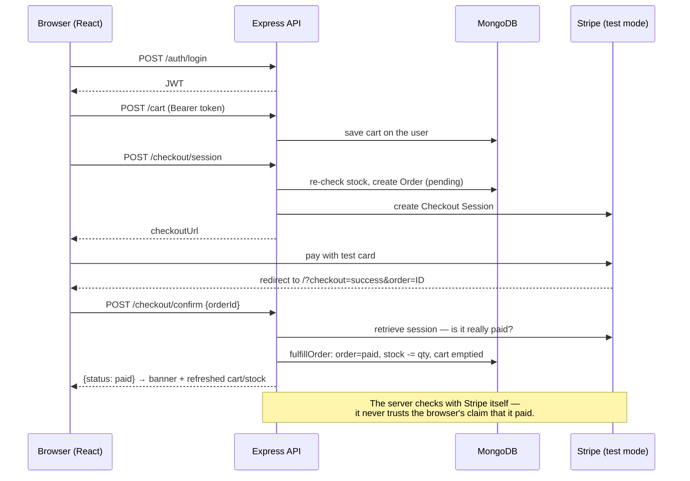

<<<<<<< HEAD
# Secure E-Commerce Engine with Checkout Sandbox

**Developer:** Fatima Nahid · **Stack:** MERN (MongoDB, Express, React with Vite, Node.js)

An end-to-end full-stack e-commerce system featuring browse mechanics, a persistent cart architecture, secure role-based routes, an automated testing sweet, and a Stripe **test-mode** checkout sandbox that enforces server-side payment verification before adjusting product inventory.

---

## 📁 System Architecture

The frontend client and backend REST API run as independent applications, communicating asynchronously over HTTP with explicit Cross-Origin Resource Sharing (CORS) protections.

```text
task4/
├── backend/            # Node.js + Express REST API (Port: 5001)
│   ├── models/         # Database schemas (User, Product, Order)
│   ├── routes/         # Endpoints (auth, products, cart, checkout)
│   ├── services/       # Stripe integrations & atomicity drivers (fulfillOrder)
│   ├── middleware/     # JWT authentication & administrative role verification
│   └── test/           # 8 automated endpoint unit tests (Stub-driven)
├── frontend/           # React + Vite Client Storefront (Port: 5173)
│   ├── src/context/    # Auth, Cart, and Global Toast notification providers
│   ├── src/components/ # Modular storefront layouts, drawers, and modals
│   ├── src/pages/      # Dynamic pages (Storefront View, Admin Catalog Manager)
│   └── test/           # 26 automated UI tests (Vitest + Testing Library)
└── README.md
```

---

## 🔄 Purchase Execution Flow



###  Architectural Focus: Zero-Trust Fulfillment
* **Post-Payment Adjustments:** Stock levels are adjusted exclusively *after* external confirmation. This avoids locking up inventory for abandoned checkouts.
* **Server Verification:** The server interacts directly with Stripe via `POST /checkout/confirm` to check session state. Landing on the success URL alone triggers no actions, and the client sees a "Confirming..." state until verified.
* **Idempotent Actions:** `fulfillOrder` updates target records atomically, preventing duplicate executions from double clicks or React development cycles.
* **Design Decision:** Verification runs on redirect rather than webhooks. This skips complex local tunneling setups (Stripe CLI) for easier inspection while ensuring identical backend security.

---

## Requirement Implementation Map

| System Requirement | Implementation Details |
| :--- | :--- |
| **Secure Token Authentication** | Powered by `bcryptjs` hashing (10 salt rounds). Session tokens are signed via 7-day `JWT_SECRET` keys. Passwords are explicitly stripped from JSON responses. |
| **Persistent User Carts** | Carts match to MongoDB user records, preserving shopping state across reloads, logouts, and multiple devices. |
| **Integrity Checks** | Item prices are calculated server-side from product documents. Stock limits are re-verified right before checking out to eliminate overselling. |
| **Protected Actions** | Core cart endpoints require standard tokens. Store mutations (Create/Update/Delete) run database lookups to verify a strict `role: admin`. |
| **Data Safety & XSS** | React automatically escapes dynamic output variables. Product pictures are strictly validated against secure standard `http(s)` protocols. |

---

##  Setup & Execution

### 1. Prerequisite Installations
* **Node.js** (Version 18 or higher)
* **MongoDB Community Server** (Local default port `27017`)
* **Stripe Developer Account** (Active test mode secret keys)

### 2. Environment Deployment
Open two terminals to run the separate environments:

#### Terminal A: API Backend
```bash
cd backend
npm install
cp .env.example .env   # Configure JWT_SECRET and Stripe private credentials
npm run seed           # Optional: Populate mock product arrays
npm start              # Service runs at http://localhost:5001
```

#### Terminal B: Front-End Storefront
```bash
cd frontend
npm install
npm run dev            # Development app boots at http://localhost:5173
```
* **Test Payments:** Use test credit card `4242 4242 4242 4242` with any future expiration and valid CVC.
* **Admin Access:** Sign up via the UI, navigate to the backend folder, and trigger `npm run make-admin -- your-email@domain.com` to grant access.

---

##  Scope & Limitations

* **Session Storage:** JWT assets reside in `localStorage` for accessibility, rather than `httpOnly` cookie variables.
* **Fulfillment Fallback:** If a client terminates their session before the success redirect completes, the order defaults to `pending`. Manual resolution is handled by hitting `/?checkout=success&order=<orderId>`.
* **Concurrency:** Simultaneous purchases hitting zero inventory limits run standard checks; production environments would utilize strict reservation locks.
* **Testing Scope:** Includes 26 frontend UI tests (Vitest + Testing Library) alongside 8 mocked backend logic workflows.

---

##  Troubleshooting Matrix

| Issue | Root Cause | Resolution |
| :--- | :--- | :--- |
| **Order stuck on `pending`** | Session terminated before redirect. | Access `/?checkout=success&order=<orderId>` while authenticated to retry. |
| **"Cannot reach the server"** | Backend down or port mismatch. | Confirm port `5001` is open and verify local CORS origins match. |
| **"Unreceived confirmation"** | Stripe payment was aborted or failed. | Check Stripe dashboard logging; cart remains intact. |

---

## Credits
Storefront layout architecture (header fields, category navigation elements, dynamic product layouts, and footer cards) inspired by Peter Kimanzi's design concepts. UI elements, core React components, and API wiring written completely from scratch.
=======
# TechMart
>>>>>>> 5c8e887eec4d3ec74e10f27c8d5008c8f273fcd3
